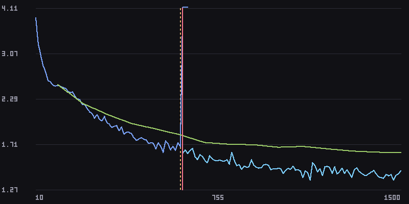
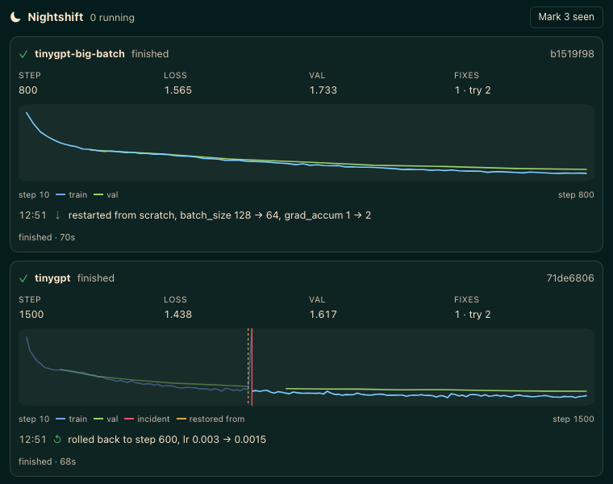

<!-- Generated from ../README.md by scripts/sync_readme.py. Edit that file instead. -->

# 🌙 Nightshift

**Hermes takes the night shift on your ML training runs.**

Start a run and go to sleep. Nightshift reads every metric as it's logged, catches NaN, loss spikes, divergence,
out-of-memory crashes and stalls, and recovers the run inside a playbook you approved. It wakes you only when it
matters, and the alert shows the chart.



<sub>A real run, not a mock-up: a char-level GPT on Shakespeare. At step 610 the loss blows up to 144. Nightshift
rolls back to the step-600 checkpoint (dashed line), halves the learning rate, and the run trains on to step 1500.
This is the chart that goes to your phone.</sub>

---

## Why

If you train models, you've lost a night of GPU time to a run that died at 3 AM, and you found out at 9. Typical
causes are a learning rate that's fine for 600 steps and then isn't, a batch that doesn't fit after a dataloader
change, or a job that hangs with the GPU at 0%.

The fix is usually mechanical: go back to the last good checkpoint, lower the LR, restart. Or halve the batch,
double the gradient accumulation, restart. Nightshift does that while you sleep, inside limits you set, and
tells you what it did.

A prompt can't do this. It takes a supervisor that runs for hours, metric parsing, process control, checkpoint
rollback, charts and push alerts. Nightshift keeps all of that in deterministic Python and makes **no model calls
while a run is healthy**.

## What it does

| Detects | How | Default playbook action |
|---|---|---|
| **NaN / Inf** in any loss | first non-finite value | roll back + restart, `lr × 0.5` |
| **Loss spike** | robust z-score over a 50-point window; two spikes in a row → critical | warn; roll back if critical |
| **Divergence** | smoothed loss stays above 1.5× its best for 30 points | roll back + restart, `lr × 0.5` |
| **Out of memory** | crash exit + CUDA / MPS / ROCm OOM patterns in the log | restart, `batch_size ÷ 2`, `grad_accum × 2` |
| **Crash** | non-zero exit, log tail kept | page you |
| **Stall** | process alive but silent for 10× its normal logging interval | page you |
| **Overfitting** | val loss rising ≥ 2% while train loss keeps falling | notify |
| **Plateau** | < 0.5% improvement over the last 15% of the run | info only (never pages) |
| **Throughput drop** | step rate halves | notify |
| **GPU idle** | `nvidia-smi` < 5% for 5 min (when present) | notify |

- **Rollback never restores a poisoned checkpoint.** Nightshift walks back from the detection to where the
  curve actually started to rise. It picks the newest checkpoint written before that point, checking both the
  step and the file time.
- **Detectors are tuned for no false positives.** Every one ships with a firing fixture and clean-curve
  fixtures. The test suite sweeps 6 healthy curve shapes × 25 seeds × 2 lengths and requires silence.

## Demo: verified in real Hermes

These are two runs of [`examples/tinygpt`](../examples/tinygpt/train.py), a 4-layer char-level GPT trained with
AdamW on the Mac GPU (MPS). It has one injected fault: past step 600, an LR above 0.002 becomes unstable. The
whole scenario has run **four times in real Hermes v0.23.0** with identical results:

| Run | What happened | Result |
|---|---|---|
| `tinygpt` (lr 3e-3) | Loss blew up to 144 at step 610 → rolled back to the step-600 checkpoint, `lr 0.003 → 0.0015` | finished, step 1500, loss 1.44 (val 1.62) |
| `tinygpt-big-batch` (batch 128) | Out of memory (simulated; the error says so) → restarted, `batch_size 128 → 64`, `grad_accum 1 → 2` | finished, step 800, loss 1.57 |



To try it yourself (needs a Python with `torch`):

```bash
PYTHON=/path/to/python-with-torch scripts/demo.sh ~/nightshift-demo   # proposes both runs; nothing starts
hermes nightshift approve <id>                                        # for each run
```

## Install

Once Nightshift is listed in the catalog:

```bash
hermes plugins install nightshift
```

Until then, from source:

```bash
git clone https://github.com/Pavilion-devs/nightshift && cd nightshift
ln -sfn "$PWD/nightshift" ~/.hermes/plugins/nightshift
hermes plugins enable nightshift
```

Requires Hermes **v0.23.0** or newer. Nightshift has **zero runtime dependencies**: everything is Python stdlib,
down to the PNG renderer and the TensorBoard reader.

## Quick start

Ask Hermes in any chat (CLI, Desktop, Telegram…):

> Train `train.py` in `~/proj` with lr 3e-4, batch 64, and watch it overnight.

Hermes reads your script's argument parser and **proposes** a run. Nothing has started yet:

```
🌙 Proposed run tinygpt [d7516822]: nothing has started yet.
  directory: /Users/you/nightshift-demo/run1
  command:   python train.py --lr 0.003 --batch-size 32 --grad-accum 1 --steps 1500
  • Automatic recovery on: divergence, nan_inf, oom, spike
  • At most 3 automatic interventions, 10 min apart
  • Rollback lowers lr ×0.5 each time (floor 1e-07)
  • Out-of-memory halves batch_size, grad_accum ×2
  • If recovery is not possible or the budget runs out, the run is stopped and you are paged
Approve with: hermes nightshift approve d7516822   (or /nightshift approve d7516822)
```

**You** approve it: `/nightshift approve <id>`, `hermes nightshift approve <id>`, or the **Approve & launch**
button in the Nightshift pane. The agent can't approve its own proposal. From then on Nightshift supervises the
run, even across Hermes restarts.

In the morning, ask "how did training go?" or run `/nightshift report`:

```
🌅 Nightshift report: 2 run(s), 2 incident(s), 2 recovered automatically, 0 stopped.
• tinygpt-big-batch: finished, 1 intervention(s), loss 1.565 @ step 800
• tinygpt: finished, 1 intervention(s), loss 1.438 @ step 1500
  12:51 oom_restart: restarted from scratch, batch_size 128 → 64, grad_accum 1 → 2
  12:51 rollback_restart: rolled back to step 600, lr 0.003 → 0.0015
```

Already have a run going? Use `watch` instead. It's read-only: alerts, no process control.

> Watch `~/proj/runs/exp7/train.log`.

### Making your command recoverable

Recovery works by re-rendering the command you approved, with **only** the values the playbook may change:

```
python train.py --lr {lr} --batch_size {batch_size} --grad_accum {grad_accum} --resume {resume}
params: {"lr": 3e-4, "batch_size": 64, "grad_accum": 1}
```

- `{resume}` becomes the chosen checkpoint's path on a rollback. On a fresh start it's dropped, along with a bare
  flag in front of it such as `--resume`.
- Checkpoints are found by name (`ckpt_*.pt`, `checkpoint-*`, `*.ckpt`, `*.safetensors`, …) or by the
  `checkpoint_patterns` you give.
- If your script can't resume, Nightshift still detects problems and pages you. It stops a broken run instead
  of letting it burn GPU.

### Metric sources

Nightshift parses metrics from the process's own stdout/stderr, with no code changes needed:
`loss=1.23`, `{'loss': 1.23, 'epoch': 0.5}` (HF Trainer), JSON lines, nanoGPT's `step 100: train loss 1.23`,
Lightning, and tqdm postfixes. It can also follow **JSONL**, **CSV** and **TensorBoard event files**, using its
own TFRecord/protobuf reader with CRC checks (no `tensorboard` package).

## Where it shows up

| Surface | What you get |
|---|---|
| **Chat** (any platform) | Six tools: `nightshift_launch` (propose), `nightshift_watch`, `nightshift_status`, `nightshift_run`, `nightshift_report`, `nightshift_ack`; plus a bundled skill that teaches the agent how to write a recoverable command |
| **`/nightshift`** | `status`, `show <id>`, `approve`, `deny`, `stop`, `ack`, `report`, `forget` |
| **`hermes nightshift`** | the same from your shell, plus `launch … -- <cmd>` and `watch <path>` |
| **Phone** | Critical incidents are pushed through Hermes's `send_message` (Telegram, Discord, …) with a rendered chart and, after recovery, a one-line root cause from your model |
| **Hermes Desktop** | A right-hand pane with live charts, incident and restore markers, the action timeline, Approve and Stop buttons, a status-bar chip (`🌙 2 runs · healthy`) and a native notification on critical incidents |
| **Web dashboard** | The same UI as a **Nightshift** tab in `hermes dashboard` |
| **Conversations** | A `pre_llm_call` hook mentions each new incident **once**, so Hermes can bring it up. It stays silent while everything is healthy |
| **Automations** | A **Morning report** blueprint: "While you slept: 2 incidents, 2 recovered" at the time you choose |

## Safety model

Nightshift runs processes on your machine, so it stays inside tight limits:

1. **Consent first.** The agent can only *propose* a run. A human approves the exact command, directory,
   playbook and intervention budget. No tool can approve, so neither the agent nor a cron job can start a process.
2. **Bounded autonomy.** A restart re-renders only the approved template, changing only the declared
   parameters (`lr`, `batch_size`, `grad_accum`, `resume`). Each change is bounded: LR floor 1e-7, batch ≥ 1, at
   most 3 interventions, 10 minutes apart. A relapse inside the cooldown, a missing checkpoint or an exhausted
   budget stops the run and pages you.
3. **No shell.** Commands run as argv lists (`shell=False`) in their own process group.
4. **Only its own processes.** Nightshift signals only process groups it started, and it re-checks the PID's
   start time before every signal, so it never kills a reused PID. Watched runs are notify-only.
5. **Silent while healthy.** No LLM calls, no notifications and no context injection unless an incident is
   open. Diagnosis runs once per critical incident, **after** recovery, capped at 3 per run.
6. **Secrets stay out.** Log tails are scrubbed (API keys, tokens, `KEY=value` secrets, URL credentials) before
   they're stored, sent to your model or pushed to a platform.
7. **One supervisor per run.** A lease in SQLite ensures exactly one Hermes process supervises each run. A run
   left behind by a crashed Hermes is adopted by the next one. Short-lived `hermes` commands never touch a run.

See [SECURITY.md](../SECURITY.md) for the threat model and [PRIVACY.md](../PRIVACY.md) for what's stored where.

### Disclosure

Once you approve a run, Nightshift:

- launches the training command as a **long-running background process**;
- may **stop or restart that process group** with only the parameter changes the playbook declares;
- reads the run's **log, metric and checkpoint paths** (and runs `nvidia-smi` when present);
- stores run data in its plugin data folder (`~/.hermes/plugin-data/nightshift/`) and alert charts in
  `~/.hermes/image_cache/nightshift/`;
- on a critical incident, may make **capped LLM calls on your configured model** with redacted log context, and
  **send an alert** through Hermes's `send_message` to your messaging platform.

No telemetry. No network calls of its own. No credentials read or stored.

## Configuration

Set in `~/.hermes/config.yaml` under `plugins.entries.nightshift.settings`:

| Key | Default | Meaning |
|---|---|---|
| `alert_target` | `""` | Where to push critical alerts, as a `send_message` target (`"telegram"` → its home channel). Empty: the chat the run was requested from. `"none"` turns pushes off |
| `diagnose` | `true` | Ask your model for a one-line root cause on critical incidents |
| `max_diagnoses` | `3` | Most diagnosis calls per run |
| `poll_seconds` | `2.0` | How often each run's metrics are read (min 0.5) |
| `start_grace_seconds` | `8.0` | How long a Hermes process must have been running before it launches, adopts or acts on a run |

Per run, the playbook (shown on the approval card) can override `max_interventions`, `cooldown_s`, `lr_factor`,
`lr_min`, the parameter names, `checkpoint_patterns`, which severities page you, and the action for each incident
type.

## Limitations

- **Single machine.** Multi-node, Slurm and Kubernetes jobs are out of scope for v0.1. You can still `watch`
  their log files.
- **Rollback needs your script to resume** from a checkpoint path passed on the command line.
- **OOM restarts from your newest checkpoint** and changes the effective batch only through
  `batch_size × grad_accum`. Your trainer has to honour both.
- Throughput and GPU-idle detection need a few minutes of history before they can fire.
- The Desktop pane is built from the same UI code as the dashboard tab (verified live in `hermes dashboard`).

## Roadmap

- W&B and MLflow API sources
- Slurm / multi-node supervision
- Per-run playbook editing in the pane before approval
- A smarter playbook: warmup re-entry after rollback, skipping the bad data shard

## Development

```bash
python3 -m venv .venv && source .venv/bin/activate && pip install -e '.[dev]'
pytest -q                                   # 430+ tests, real processes, no sleeps in detector tests
ruff check . && ruff format --check .
python scripts/build_ui.py                  # regenerate the Desktop and dashboard bundles from ui/core.js
python scripts/sync_readme.py               # copy this README into the plugin folder for the catalog page
python -m nightshift.core.cli_dev launch -- python examples/synthetic/train.py --unstable-after 600
```

The engine (`nightshift/core/`) is pure stdlib and never imports Hermes. Everything Hermes-specific lives in
`nightshift/adapter/`, `nightshift/dashboard/` and `nightshift/desktop/`. CI runs on Python 3.11–3.14, Linux
and macOS.

Built for the Nous Research **Hermes Agent Plugin Hackathon**. MIT licensed.
